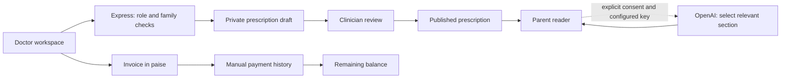

# Billing, prescriptions and parent help

## Try locally

Run `sh start-local.sh`, open http://127.0.0.1:3000/portal and use Doctor demo. Use fictional data only. Switch to Parent demo to see the same family's published documents.

1. **Prescriptions → Write prescription:** select a child, optionally link a visit, enter medicine name/strength, dose, frequency, duration, route, advice and registration number. Save a draft. Drafts are visible only to the clinic.
2. **Review & publish:** check the review confirmation. Publication makes the document visible to that child's parent. Published documents cannot be edited; void an incorrect document with a reason and create a replacement. Voided history remains visible.
3. **Billing → Create invoice:** enter INR line items, quantities and discount. The server calculates the total in integer paise. Issue the invoice, then record payments actually received. Partial payments retain a balance; full payment marks it paid. Payment retries use an idempotency key. Unpaid invoices can be voided with a reason.
4. **Print:** use the document's print button and choose Save as PDF in the browser print dialog. Demonstration documents are labelled as fictional. No digital signature is applied.
5. **Parent → Prescription help:** choose a published prescription and ask about recorded instructions, purpose or follow-up. English/Hindi field explanations accompany the doctor's original unchanged text. The reader works without an AI account.

## How the pieces connect



`components/CareWorkspace.tsx` owns forms and document views. `server/care-routes.mjs` validates requests, enforces ownership, records audit events and uses revision checks to reject stale writes. `server/parent-assistant.mjs` implements the reader and optional AI adapter. `server/care.test.mjs` tests these rules.

Local SQLite receives additive tables from `server/care-schema.mjs` on startup. Hosted D1 receives migration `drizzle/0001_crazy_hydra.sql`; preserve migration 0000 and the journal. Do not reset an existing database to enable these features. Cloud and local records are independent.

## Optional AI configuration

Configure `OPENAI_API_KEY` and `OPENAI_MODEL` on the **server**, restart it, and select the AI option with consent in the parent form. For hosting, configure runtime secrets rather than committing credentials. The OpenAI Developers plugin can assist with secure key setup. Do not put keys in chat, frontend code or a `NEXT_PUBLIC_` variable.

The adapter uses the Responses API with strict structured output and `store:false`. It sends the question and medicine names, without automatically including the child's name, date of birth, history or billing. Parents should avoid personal identifiers in questions. `store:false` does not promise zero provider retention; review [OpenAI data controls](https://developers.openai.com/api/docs/guides/your-data) before clinical use.

AI selects a relevant section and medicine index; the application copies saved clinician text. It does **not** generate doses, diagnoses, interactions or treatment changes. Clinical questions are directed to the clinician. Provider failures fall back to the clearly labelled record reader. See [structured outputs](https://developers.openai.com/api/docs/guides/structured-outputs).

Live AI remains disabled until a key and model are configured. Tests use a mocked provider; they do not validate live model behavior. Clinical evaluation and appropriate privacy review remain necessary before using real patient information.

## API and verification

Authenticated reads: `GET /api/prescriptions`, `GET /api/prescriptions/:id`, `GET /api/invoices`, `GET /api/invoices/:id`, `GET /api/care/capabilities`.

Doctor writes: `POST /api/prescriptions`, `PATCH /api/prescriptions/:id`, `POST /api/prescriptions/:id/publish`, `POST /api/prescriptions/:id/void`, `POST /api/invoices`, `POST /api/invoices/:id/payments`, `POST /api/invoices/:id/void`. Updates require the current revision; publish requires `confirm:true`. Payment requests require a UUID `request_id`.

Parent help: `POST /api/parent-assistant` with `prescription_id`, `question`, `language` (`en` or `hi`), `use_ai` and `consent`. Only that parent's current published prescriptions are eligible. The response identifies its source revision and whether AI was used.

```sh
pnpm test
pnpm typecheck
pnpm build
```

The suite covers authorization, hidden drafts, stale revisions, immutable publication, invoice arithmetic, competing payments, idempotency, consent, minimal AI payloads and invalid provider output.

## Boundaries and next additions

This is a demonstration workflow, not a validated clinical or tax system. Payment recording does not collect money; there is no gateway, refund flow, tax calculation, credit note, prescription e-signature or verified registration lookup. Those require dedicated integrations and operational review. Next additions can include payment webhooks, refund/credit-note accounting, configurable invoice numbering, clinician-approved templates, signed prescriptions and evaluated multilingual medical explanations.
