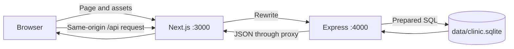
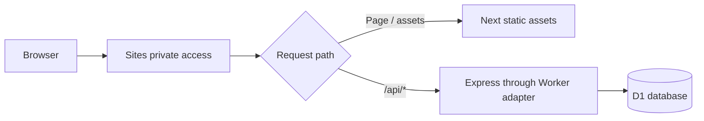

# 1. From DSA to a full-stack application

## A browser is another program

The browser renders HTML, styles it with CSS, and executes JavaScript. It can store temporary UI state and send network requests. It cannot be trusted to enforce clinic permissions: users can modify browser code or call endpoints directly.

The server receives requests from browsers and other clients. It validates input, identifies the user, checks permissions, applies business rules, and reads or writes storage. A database keeps the durable state after page refreshes or server restarts.

| Familiar idea | Web development equivalent | Difference to remember |
|---|---|---|
| Function arguments | Request body, URL parameters, query string | Input comes from outside your program |
| Return value | HTTP status plus JSON response | Network calls can fail or arrive late |
| Array of objects | Database query results | Usually only a subset of durable records |
| Object identifier | Primary key | Identifies a record across requests |
| Condition check | Validation or authorization | Must run on the server too |
| Function composition | Middleware pipeline | Each stage can reject the request |
| State transition graph | Appointment status rules | Some transitions must be forbidden |
| Shared mutable state | Database rows | Concurrent requests can race |

## Technologies in this repository

**JavaScript** is the language executed by browsers and Node.js. **TypeScript** adds compile-time type checking. `.tsx` files contain TypeScript and JSX, which describes UI elements. `.mjs` files here are JavaScript modules using `import` and `export`.

**React** builds the interface from components. A component is a function describing what the screen should look like for the current state. `useState` remembers values between renders. Calling its setter schedules a new render; it does not immediately rewrite an ordinary local variable.

**Next.js** organizes the React application into page routes, development tooling, and builds. The `app/portal/page.tsx` file serves `/portal`. Next.js can run server features, but this project's business API is a separate Express application. In the hosted build, Next exports static frontend assets.

**Node.js** runs JavaScript outside the browser. **Express** handles HTTP routing and middleware on that runtime. **Zod** checks request data at runtime. **SQLite** stores relational data locally. **D1** provides the hosted database used by this deployment. **Drizzle Kit** generates the cloud schema migrations; endpoint queries are still written as SQL.

**pnpm** installs dependencies and runs scripts from `package.json`. The lockfile records resolved dependency versions. Use frozen installation to reproduce the repository rather than casually upgrading its dependencies.

## Local architecture



The browser sees one origin: `http://127.0.0.1:3000`. Next forwards `/api/*` to `http://127.0.0.1:4000`. This is configured in `next.config.ts`; it is not magic in React.

An **origin** consists of scheme, host, and port. `http://localhost:3000`, `http://127.0.0.1:3000`, and `http://127.0.0.1:4000` are different origins. This matters for cookies and the backend's write-origin check.

## Hosted architecture



Static frontend does not mean fake backend. The delivered HTML, JavaScript, and CSS are static files, while booking and authentication still call a live API with a persistent database. The Worker uses a Node-compatible HTTP adapter; it is not an always-running Node virtual machine.

Your laptop database and hosted database are separate. A local booking does not appear online. Publishing new code does not upload `data/clinic.sqlite` or your `.env`.

## HTTP is the function-call protocol

A simplified booking request looks like this. The date and identifiers below are illustrative; use a real future published slot and a child returned by your local API.

```http
POST /api/appointments
Content-Type: application/json
Origin: http://127.0.0.1:3000
Cookie: clinic_session=<browser-managed-token>

{
  "child_id": "child-aarav",
  "day": "2030-01-15",
  "time": "10:00",
  "type": "Follow-up",
  "reason": "Review the previous visit"
}
```

Success is `201 Created` with JSON such as `{"id":"generated-uuid"}`. HTTP methods describe intent: GET reads, POST creates or invokes an action, PATCH changes part of an existing resource. This repository does not require every feature to implement all methods.

| Status | Meaning here | Example |
|---|---|---|
| 200 | Successful request | Read children |
| 201 | Created | Book appointment |
| 400 | Invalid input/business request | Invalid date or unpublished slot |
| 401 | Authentication missing/invalid | Expired session |
| 403 | Action forbidden | Parent tries to publish a note; wrong Origin |
| 404 | Not found or not accessible | Another family's child |
| 409 | Conflict | Slot booked by another request |
| 413 | Body too large | JSON exceeds configured limit |
| 429 | Too many requests | Rate limit exceeded |
| 500 / 503 | Server or service problem | Unhandled route failure / Worker initialization failure |

## State exists in different places

| Location | Examples | Lifetime |
|---|---|---|
| React state | Open modal, selected child, loading flag | Usually until reload/navigation unmount |
| Browser cookie | Opaque session token | Until expiry/logout/replacement |
| Database | Users, children, appointments, notes | Persists until changed/deleted |
| Environment | API URL, database path, origin | Configuration for a process/deployment |

A loading spinner is UI state. An appointment is database state. Do not confuse a green success message with proof of persistence: refresh and inspect the actual API result.

## Async programming without mysticism

```ts
const appointments = await api<Appointment[]>('/appointments');
```

`api()` returns a Promise: a future result. `await` pauses that async function until the result arrives. It does not freeze all JavaScript execution. In the portal, independent child and appointment requests use `Promise.all` so they can be in flight together.

But `async` does not turn CPU work into parallel computation. The local database uses synchronous SQLite calls, and password hashing uses `scryptSync`; those operations occupy the JavaScript thread while they execute. An async wrapper does not remove that cost. This becomes important when discussing throughput.

React effects run side effects such as loading data when a selected child changes. Cleanup flags in this UI prevent stale responses from updating some unmounted/outdated views; they are not a full network cancellation system.

## Check your understanding

Explain each answer before reading the final phrase:

1. Why is an appointment still present after refresh? **The API persisted it in the database.**
2. Why does changing a React array not necessarily change the database? **UI state and durable state are separate.**
3. Why use a backend when the browser can validate forms? **The browser is untrusted and cannot enforce shared rules.**
4. Is the hosted app still full-stack after static export? **Yes; its API and database remain dynamic.**
5. Does `await` make `scryptSync` nonblocking? **No.**
