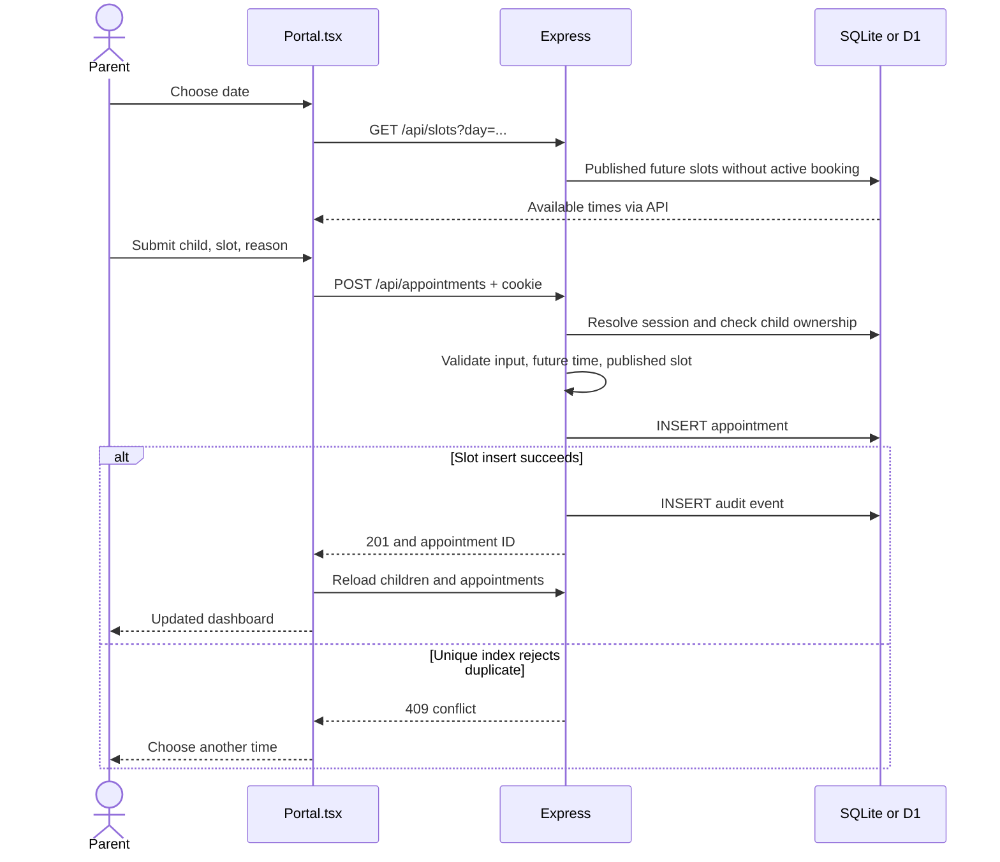
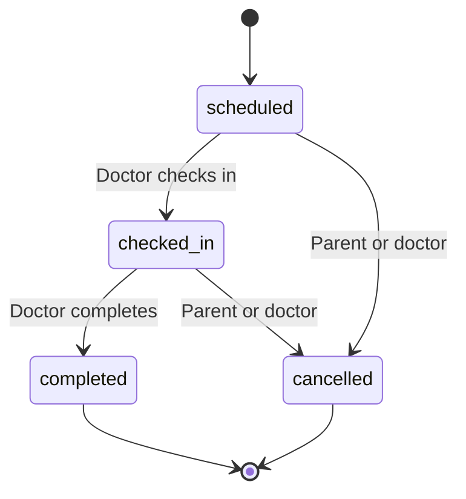

# 2. Follow real code from click to record

Read these source files alongside this lesson. The small examples below are extracted or simplified teaching examples; the source files remain authoritative.

## Start with the file boundaries

| Change you want | Start here | Then inspect |
|---|---|---|
| Landing page wording | `app/page.tsx` | `app/layout.tsx` metadata |
| Colors, layout, responsive behavior | `app/globals.css` | Relevant component markup |
| Brand name/mark | `components/Brand.tsx` | Landing content and `/api/clinic` |
| Booking form or dashboard | `components/Portal.tsx` | `lib/api.ts`, relevant backend route |
| Validation or permissions | `server/app.mjs` | `server/api.test.mjs` |
| New persistent field | `server/local-db.mjs`, `db/schema.ts` | Migrations, inserts, seed, API, types, UI |
| Local ports or startup | `scripts/dev.mjs`, `server/index.mjs` | `.env`, `next.config.ts` |
| Cloud behavior | `hosting/worker.mjs` | Database adapter, build, seed |

The portal is currently a large component. It is convenient for seeing the MVP in one place, but splitting it into feature components and hooks would improve maintainability. Do not mistake its compact formatting for a pattern you must copy.

## Reading a React component

Conceptually, a booking form behaves like this:

```tsx
const [busy, setBusy] = useState(false);
const [error, setError] = useState('');

async function submit(event: React.FormEvent<HTMLFormElement>) {
  event.preventDefault(); // Do not navigate away using native form submission.
  const form = new FormData(event.currentTarget);
  setBusy(true);
  try {
    await api('/appointments', post({
      child_id: form.get('child_id'),
      day: form.get('day'),
      time: form.get('time'),
      type: form.get('type'),
      reason: form.get('reason'),
    }));
    // Reload appointments and display success.
  } catch (error) {
    setError(error instanceof Error ? error.message : 'Request failed');
  } finally {
    setBusy(false);
  }
}
```

The actual portal uses shared submission helpers for several forms. `FormData` reads named inputs. `preventDefault()` prevents a full page submission. `try/catch/finally` handles success, failure, and cleanup. Disabling the button while busy improves UX, but it cannot prevent two separate browsers from booking the same slot.

## The HTTP helper

`lib/api.ts` contains the real helper:

```ts
export async function api<T>(path: string, options?: RequestInit): Promise<T> {
  const response = await fetch('/api' + path, {
    ...options,
    headers: { 'Content-Type': 'application/json', ...options?.headers }
  });
  const body = await response.json().catch(() => ({}));
  if (!response.ok)
    throw new Error(body.error || 'Unable to connect. Please try again.');
  return body;
}
```

`...options` copies supplied request options. The helper prefixes `/api`, parses JSON, and converts an unsuccessful HTTP response into a thrown error. `fetch` does not throw just because the server returns 400; this helper explicitly checks `response.ok`.

The generic `<T>` helps the TypeScript compiler know the expected shape. It does **not** validate response JSON at runtime. The same-origin browser request automatically includes the applicable cookie. JavaScript cannot read the HttpOnly session token.

## Booking, step by step



1. Opening the booking modal triggers slot loading for the selected day.
2. Availability is advisory: another request may book a displayed slot before you submit.
3. Origin checks and rate limiting run before the protected endpoint.
4. Authentication resolves the session cookie into `req.user`.
5. Zod validates the body, including the allowed visit types and reason length.
6. `childAccess()` checks the child belongs to this clinic and, for a parent, this user.
7. The route rejects past appointments and times that were not published.
8. The database insert enforces the final booking invariant.
9. Success is audited, then the route returns 201.
10. The UI reloads server data and displays the result.

Notice that `parent_id` is derived from the authorized child record. It is not trusted from a user-supplied JSON field.

## Middleware order is part of security

The Express application roughly registers:

```text
Headers + JSON parser
→ Origin check + rate limits
→ Public health, clinic, login, registration routes
→ Session authentication middleware
→ Protected routes, with doctor middleware where needed
→ Unknown endpoint handler
→ Error handler
```

Registering a new private route above the authentication middleware could expose it. Registering it after the fallback 404 could make it unreachable. The order matters as much as the handler body.

`doctor` checks role. `childAccess` checks the resource scope. They answer different questions: “May this role perform this kind of action?” and “May this user access this particular child?”

## Login is another request flow

```text
Email + password
  → Find user by clinic and normalized email
  → Verify salted scrypt hash
  → Generate random session token
  → Store SHA-256(token), user ID, expiry
  → Send raw token in HttpOnly cookie
  → Later requests hash the cookie and look up the session
```

The password itself is not stored. The session token is not a JWT; it is an opaque random value backed by a database row. Server-side logout deletes this user's sessions, so it currently signs out all of that user's sessions, not just one device.

Session expiry is eight hours in the current code. A page that remains open can outlive its session; a later request then receives 401. Better centralized expired-session handling is a useful future UI improvement.

## State transitions



The database value is `checked-in`; the diagram uses `checked_in` as an identifier. The current backend allows parents to cancel their own checked-in appointments too. That is an implemented rule, not necessarily the final clinic policy.

`scheduled → completed` is rejected. Completed and cancelled records cannot transition again through this endpoint. The current implementation checks the old state then updates in a separate operation; see the concurrency exercise for the remaining race.

## Why the same backend works locally and online

`createApp({ db })` receives a database adapter rather than opening a file itself. Both adapters offer `prepare(sql).run/get/all`.

Local `DatabaseSync` returns values synchronously. The D1 adapter returns Promises and maps platform results into the same basic shapes. Routes `await` both. This is **dependency injection**: supply a dependency to business logic rather than hard-code its construction inside every function.

It also enables tests to provide an in-memory database. This reduces infrastructure duplication, but SQL syntax and transaction semantics still require care if you later move to PostgreSQL.

## Trace a feature yourself

Search for these exact strings:

```sh
rg -n "appointments|childAccess|one_booking_per_slot" components/Portal.tsx lib/api.ts server db
rg -n "assistant/brief|structured-preview" server/app.mjs components/Portal.tsx
```

For each feature write five lines: UI trigger, URL/method, validation, authorization, database change. If you can do this for booking, notes, and vaccines, you understand the main request patterns in this application.
