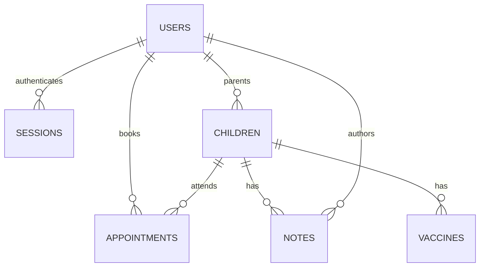

# 3. Data, security, and correctness

## Think in entities and relationships

A relational database stores rows in tables. A primary key identifies a row. A foreign key connects it to another table. A query can join tables to produce the combined view the UI needs.



This diagram shows the principal declared relationships. Slots connect to appointments logically by tenant/day/time, rather than by a `slot_id` foreign key. Audit actor/resource fields are identifiers, not a complete set of foreign-key relationships.

| Table | What one row means | Important fields |
|---|---|---|
| `users` | A parent or doctor account | id, tenant, email, password hash, role |
| `sessions` | One signed-in session | hashed token, user_id, expiry |
| `children` | A child owned by one parent account | id, tenant, parent_id, dob, allergies |
| `slots` | A clinic-published appointment time | tenant, day, time |
| `appointments` | A booked visit | child_id, parent_id, day, time, status, reason |
| `notes` | A doctor-published child note | child_id, doctor_id, body, created |
| `vaccines` | A manually entered vaccine plan/record | child_id, name, due, administered |
| `audit` | A recorded application event | actor, action, resource, created |

The current child model has one parent account. Multiple children per parent are supported; multiple guardians per child are not. A future guardian association table would be a distinct product and permission change.

## Sample data, not real patient data

The fictional demo includes a parent and two children, Aarav and Meera. A simplified relationship looks like:

```text
users:        parent-demo → Ananya Sharma
children:     child-aarav → parent-demo
appointments: apt-1 → child-aarav + parent-demo
notes:        note-demo → child-aarav + doctor-demo
```

The names appear on the dashboard through JOINs. Appointment rows do not need to duplicate the current child name in every booking. IDs remain stable if display text changes.

Dates of birth and appointment days are `YYYY-MM-DD` strings. Times are `HH:mm`. Appointment comparisons use IST, and creation timestamps use ISO strings. A birth date is a calendar date, not a precise moment; careless timezone conversion can change which day is displayed.

## Queries you should understand

Read a parent's children, with bound parameters:

```sql
SELECT id, name, dob
FROM children
WHERE tenant = ? AND parent_id = ?
ORDER BY name;
```

The `?` placeholders receive values separately. Do not construct SQL by concatenating arbitrary user input. Parameter binding prevents input from becoming SQL syntax; it does not decide whether the user is authorized.

Join appointments to child names:

```sql
SELECT a.id, c.name AS child_name, a.day, a.time, a.status
FROM appointments a
JOIN children c ON c.id = a.child_id
WHERE a.tenant = ? AND a.parent_id = ?
ORDER BY a.day, a.time;
```

Count actual persisted appointments by state:

```sql
SELECT status, COUNT(*) AS total
FROM appointments
WHERE tenant = ?
GROUP BY status;
```

`WHERE` selects rows, `JOIN` combines related rows, `GROUP BY` groups them, and `COUNT` aggregates. An index helps the database locate or order relevant rows, but adds storage and write cost. SQL indexes are not automatically equivalent to a JavaScript hash map.

## Preventing double booking

The database defines:

```sql
CREATE UNIQUE INDEX one_booking_per_slot
ON appointments(tenant, day, time)
WHERE status != 'cancelled';
```

An **invariant** is a property that must remain true: at most one non-cancelled appointment occupies a clinic's day/time slot.

Without database enforcement:

```text
Request A: checks slot → free
Request B: checks slot → free
Request A: inserts
Request B: inserts
Result: double booking
```

With the unique index, one competing insert wins and the other fails. The endpoint translates that constraint failure into HTTP 409. Cancellation removes that row from the partial index, freeing the slot. Completion does not free it.

The rule currently models one simultaneous appointment per clinic. Multiple doctors, rooms, different durations, and overlapping intervals require a richer resource model. Merely adding more servers does not solve scheduling design.

## Authentication, authorization, and isolation

**Authentication:** Who is making the request? The session lookup establishes a user.

**Authorization:** May this user perform this action? Doctor middleware blocks parent note publication. Family checks block access to another parent's child.

**Tenant isolation:** Which clinic does the data belong to? Queries include a tenant condition, but the application currently hard-codes `ruchi-lamyan`. It does not yet derive tenants from verified domains or provision clinics.

| Existing protection | What it helps with | What it does not prove |
|---|---|---|
| Salted scrypt password hashing | Avoid storing plaintext passwords | No MFA, verification, or reset workflow |
| HttpOnly session cookies | JS cannot directly read session token | Not a complete defense against malicious scripts |
| Secure hosted cookies | Send session over HTTPS | Does not encrypt database contents |
| SameSite plus exact write Origin | Reduce cross-site cookie write abuse | Not a replacement for authorization or XSS prevention |
| Zod schemas | Reject malformed/invalid input | Do not establish user identity |
| Prepared SQL | Prevent input becoming SQL syntax | Does not prevent data access mistakes |
| Unique booking index | Enforce slot invariant | Does not make all route operations atomic |
| Audit events | Record selected reads/changes | Not immutable/tamper-evident compliance logs |
| Request limits and security headers | Basic abuse mitigation | Not a distributed security system |

The hosted rate limiter uses an in-memory store in each running instance/isolate. It is not a globally coordinated limit. The trusted Sites user header is an assumption of the current platform boundary; do not trust arbitrary client headers if moving elsewhere.

## Tests are executable claims

`server/api.test.mjs` creates an in-memory SQLite database and sends actual HTTP requests to an ephemeral local server. It does not need to change your persisted demo database.

Current coverage includes:

1. Authentication required for protected records.
2. Bad login rejected.
3. Cross-origin writes rejected.
4. Family and staff permissions enforced.
5. Impossible/future birth dates rejected.
6. Competing bookings return one success and one conflict; cancellation frees a slot.
7. Past/unpublished slots rejected.
8. Invalid sequential appointment transitions rejected.
9. Doctor notes visible to the parent and audited.
10. Vaccine actions restricted and future administration rejected.
11. Brief remains a structured preview preserving source text.
12. Other-tenant records excluded.
13. Logout invalidates authentication.

Run `pnpm test` or, with dependencies installed and Node on PATH, `node --run test`. Read a test as **arrange → act → assert**: prepare records, make a request, verify status/body/storage.

The competing booking test is valuable because it checks a business invariant under concurrent requests. A test that merely repeats a UI label is much weaker. Local adapter tests do not automatically prove hosted adapter behavior; cloud emulation and deployment smoke checks are separate layers.

## Real limitations worth understanding

- **Status race:** The endpoint reads an appointment's status and later updates it without checking that old status in the UPDATE. Two concurrent transitions can both pass validation. Use a conditional update and check affected rows.
- **Write/audit atomicity:** Business writes and audit inserts are separate. An audit failure can cause an error response after the appointment was already stored. Transactions or a durable event strategy should address this.
- **Registration race:** Checking email existence before insertion does not eliminate simultaneous registrations. The unique constraint remains authoritative; translate its failure into a conflict response.
- **Unbounded listing:** The UI fetches full lists. Pagination and server-side filters become necessary as data grows.
- **Schema drift:** Local schema initialization and cloud migrations are separate. Additional cloud indexes are not automatically present locally.
- **No idempotency key:** The slot invariant prevents duplicate occupation, but reliable retries for general writes need a deliberate idempotency design.

These are useful engineering follow-ups, not claims that every operation is unsafe. Be precise about which guarantees exist and which remain to be built.
