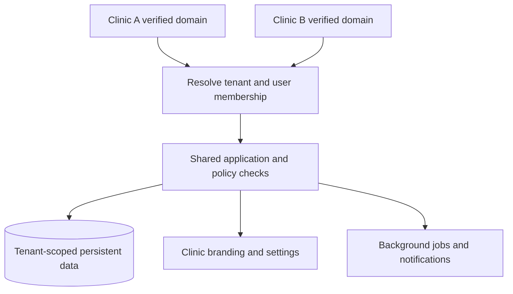

# 6. Explain the product and defend the engineering

## A client explanation in 45 seconds

“This is a branded clinic portal for Dr. Ruchi Lamyan's pediatric practice. Parents can manage child profiles, book available appointments, and view clinician-published follow-up notes and vaccination records. The doctor has a separate view for appointment management, visit status, availability, and records. The current version is a working private demonstration. Payments, automated reminders, teleconsultation, and onboarding multiple clinics are future phases.”

Lead with the workflow and its value. A client buying clinic software usually wants less booking friction and a clearer follow-up experience before they want to hear about Express middleware.

Avoid claiming measured time savings, patient outcomes, regulatory compliance, unlimited scalability, or a real AI assistant. None has been established here.

## A five-minute demonstration

| Time | Demonstrate | Explain |
|---|---|---|
| 0:00–0:45 | Landing page | Practice identity and clinic information |
| 0:45–2:00 | Parent dashboard and booking | Child-specific appointment request using published availability |
| 2:00–3:15 | Doctor view and status change | Separate staff workflow and controlled visit states |
| 3:15–4:15 | Doctor note, then parent records | Follow-up information stays connected to the child |
| 4:15–5:00 | Structured brief and roadmap | Existing record summary; distinguish planned AI and commercial features |

Use fictional records. Prepare a future slot in advance. Use separate browser profiles for parent/doctor if switching quickly. Do not promise that an owner's private hosting link is already a public patient website.

Ask the client about appointment duration, schedule exceptions, cancellation policy, multiple doctors, guardians, communication consent, billing, and record responsibilities. These answers determine real business rules; they should not be guessed from a UI mockup.

## White-label commercialization

The long-term product is a shared software platform with each clinic's identity, domain, staff, configuration, and isolated records. Creating copies of the entire repository for every clinic would make updates and security fixes expensive.

The present tenant column is a starting point, but the tenant is fixed in code. A commercial design needs tenant provisioning, verified domain mapping, user memberships/roles, configuration management, subscription billing, and operational tooling.



This diagram is a proposed future architecture, not the current deployed implementation. Evaluate shared-database versus separate-database tenancy using isolation, cost, operational complexity, and customer requirements.

## A credible staged roadmap

| Stage | Main goal | Evidence required before advancing |
|---|---|---|
| Current MVP | Demonstrate core clinic workflow | Existing functional checks and usable demo |
| Single-clinic pilot | Reliable, approved real-world operation | Identity/consent policies, access review, backups/restore, recovery, monitoring, approved clinical workflow |
| Commercial platform | Repeatable onboarding and operation | Tenant provisioning, verified domains, billing, support and isolation tests |
| Growth | Measured capacity and service reliability | Load tests, latency/error metrics, capacity planning, incident response |
| Mobile | Native user experience on same product | Versioned API, suitable mobile auth, push notification model, app release processes |

Clinical/legal obligations must be assessed for the actual service before launch; this guide is a technical training document, not a legal determination. Production planning should be validated with the relevant experts and current requirements.

## AI: present implementation versus future design

Today's `/api/assistant/brief` reads one appointment and its child information and formats four sections: patient, visit, parent-reported concern, and recorded allergies. It returns `mode: 'structured-preview'`. No model infers a diagnosis, generates treatment, or receives the records.

A future model-assisted documentation flow could be:

```text
Authorized doctor selects visit
 → Server retrieves minimum relevant authorized records
 → Approved model produces a draft with source references
 → Validation and uncertainty checks
 → Doctor reviews/edits
 → Explicit publication to parent
 → Audit the source, version, reviewer, and final output
```

That requires suitable data handling agreements, consent/policy decisions, evaluation, cost limits, failure behavior, and prompt-injection defenses. Clinical note text is untrusted data, not instructions for a model. Retrieval must preserve tenant and patient access boundaries.

Begin with lower-risk documentation assistance and evaluate omissions, invented facts, unsupported statements, and source fidelity. Do not invent accuracy percentages before collecting a reviewed evaluation set. No API key is currently required for the existing structured summary.

## Your 90-second interview introduction

“I worked on a pediatric clinic platform with a Next.js/React frontend and an Express API. Parents manage children and appointments, while doctors manage availability and publish records. The local app uses SQLite, and the private hosted version reuses the API with a D1 adapter. I separated UI validation from backend authorization and used a partial unique index to prevent concurrent bookings for the same slot. The backend has integration tests for authentication, family isolation, booking conflicts, state transitions, and record access. The current product is a single-clinic MVP; full tenant provisioning, production operations, and real AI integration remain future work.”

Use “I implemented” only for work you actually performed and understand. It is fine to explain that you used an AI coding assistant, then describe what you inspected, changed, tested, and can defend independently. Completing the labs gives you concrete ownership stories.

## Questions you should be able to answer

**Why Next.js and Express together?**

Next organizes the UI and its build; Express contains a separately testable API that future web/mobile clients can use. The cost is more infrastructure and integration than a single framework's API routes. This separation is a design choice, not a universal requirement.

**Why SQLite first? When would you change it?**

It keeps local setup simple and gives relational constraints. The hosted demo uses D1 through an adapter. I would measure actual query load, write contention, latency, recovery needs, and operational limits before choosing a production database architecture. A PostgreSQL migration would require SQL/schema/adapter and operational work, not just changing a connection string.

**How do you prevent double booking?**

Availability checks improve UX, but the partial unique index on tenant/day/time for non-cancelled appointments is authoritative. Concurrent inserts cannot both occupy the same slot; the loser receives 409. This is stronger than disabling a submit button.

**How do you prevent a parent reading another child's records?**

The backend authenticates the session and queries by child ID, tenant, and the authenticated parent's ID. UI visibility is not the protection. Unauthorized ownership lookups return 404 without confirming the record exists.

**Why opaque sessions rather than JWTs?**

Database-backed sessions make revocation straightforward and avoid embedding user claims in a browser-readable token. They require a server-side lookup. The token is random, the database stores its hash, and the browser receives an HttpOnly cookie. JWTs are an alternative with different revocation and claim-freshness tradeoffs, not an automatic upgrade.

**What is the difference between hashing and encryption?**

Hashing is one-way verification; encryption is reversible using a key. Passwords use salted, deliberately expensive scrypt hashes. Random session tokens are hashed with SHA-256 for lookup. Neither mechanism means all patient data in storage is encrypted by the application.

**How are you handling concurrency?**

The booking invariant is enforced by the database. Some other operations still need work: status transitions read then update without a conditional old-state check, and audit writes are separate. I would use conditional updates and appropriate transaction/event patterns for those guarantees.

**What does dependency injection buy you here?**

`createApp({db})` runs against local SQLite, the cloud adapter, or test storage. Business logic does not construct its own storage in each route. That improves testability and hosting flexibility while preserving one policy implementation.

**What is the time complexity?**

A simple frontend filter is O(n), and full-list responses cost O(n) in transfer/rendering. One current upcoming-list path nests membership scanning within filtering and can approach O(n²); a Set or direct predicate can improve it. Database queries depend on indexes, cardinality, and query plans, so I would not claim every query is O(1). Pagination is a more important growth step than micro-optimizing tiny demo arrays.

**How would you scale this?**

First define workload and a target latency/error budget. Measure. Add pagination and suitable indexes, shared/durable abuse controls, managed backups and restore tests, monitoring, and background jobs for slow external work. Resolve tenant provisioning and isolation. Use a database and deployment design appropriate to measured load. Adding replicas alone does not fix synchronous hashing, database contention, or missing correctness rules.

**What would you test next?**

Concurrent status transitions, registration uniqueness races, failures between business/audit writes, session expiry UX, hosted adapter parity, and tenant-domain resolution when introduced. Then workload and recovery tests once the target environment and launch scope are defined.

**What is your biggest tradeoff?**

The MVP keeps a small number of files and dependencies easy to run, but the large portal/API files and duplicated local/cloud schema paths become harder to maintain as features grow. I would refactor along feature boundaries while preserving integration tests.

## Tell an engineering story with evidence

Use this structure for an interview answer:

1. **Problem:** Two parents might choose the same available slot.
2. **Failure mode:** Both clients read availability before either writes.
3. **Decision:** Enforce uniqueness in the database and return a conflict.
4. **Evidence:** Concurrent-request test expects one 201 and one 409; cancellation releases availability.
5. **Limit:** The current invariant models one simultaneous visit per clinic, not multiple resources or overlapping durations.

Do not claim a user count, uptime percentage, revenue, performance improvement, or production adoption without measurements. “Tested with competing requests” is a defensible claim; “scales to millions” is not.

## Graduation exercise

Without reading these notes, demonstrate a booking, identify all four relevant source layers, explain the SQL constraint, reproduce a rejected unauthorized request, run the tests, make one small change, and explain how it would reach the hosted version. Then give the client pitch and answer five interview questions aloud.

If you get stuck, identify the missing concept and return to that lesson. Understanding is demonstrated by making and verifying changes, not by remembering every line of code.
